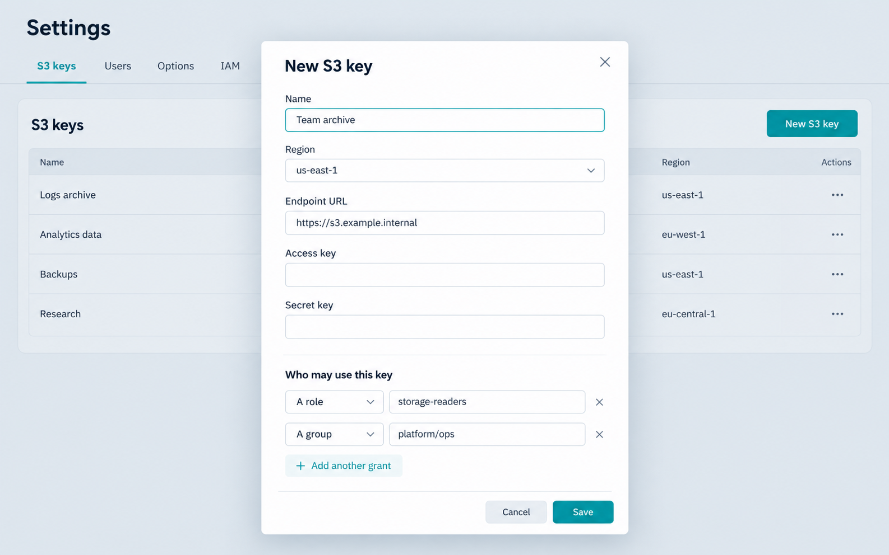

# Authentication

S3 Web UI can use local accounts, OIDC single sign-on, or a deliberately unprotected mode for an already trusted network. This guide explains application identity; see the [administration overview](Administration.md) for granting the S3 keys that identities may select.

## OIDC in plain language

OpenID Connect (OIDC) is an identity layer built on OAuth 2.0. Instead of S3 Web UI collecting and checking a person's password, it redirects them to an **identity provider** (IdP), such as Keycloak, Entra ID, Okta, or Authentik. The IdP authenticates the person and redirects the browser back with signed identity information. S3 Web UI verifies that information, starts its own browser session, and never receives the person's IdP password.

An OIDC client needs four pieces of information:

| Item | Meaning |
|---|---|
| Issuer URI | The IdP's stable OIDC address. S3 Web UI uses it to discover authorization, token, and signing-key endpoints. |
| Client ID | The IdP's identifier for this S3 Web UI installation. |
| Client secret | A credential held by the application to authenticate the authorization-code exchange; store it in a secret manager or Kubernetes Secret. |
| Redirect URI | The return address registered at the IdP, normally `https://<public-host>/login/oauth2/code/<registration-id>`. |

At sign-in, the browser is redirected to the IdP, the user authenticates there, and the IdP returns an authorization code to the redirect URI. S3 Web UI exchanges that code server-side for OIDC tokens and validates their signature, issuer, audience, and expiry. The e-mail claim is the application's stable user identity. The app requests the standard `openid`, `profile`, and `email` scopes.

OIDC authenticates the person; it does not grant S3 permissions by itself. S3 Web UI uses its own S3-key grants to decide which stored storage connections the signed-in person may select.

S3 Web UI has three authentication modes. By default it requires a local account. OIDC can add
single sign-on alongside local accounts. `DISABLE_AUTHENTICATION=true` is an explicit opt-out that
disables both of those mechanisms and must only be used behind a trusted network boundary.

| `DISABLE_AUTHENTICATION` | `OIDC_ENABLED` | Behaviour |
|---|---|---|
| `false` (default) | `false` (default) | Local e-mail/password sign-in |
| `false` | `true` | Local e-mail/password sign-in and one or more OIDC sign-in buttons |
| `true` | either value | No sign-in; every visitor is a virtual administrator. OIDC is ignored |

## Local accounts

Local authentication is enabled unless `DISABLE_AUTHENTICATION=true`. On an empty user database,
S3 Web UI creates an administrator with `ADMIN_EMAIL` and `ADMIN_PASSWORD`; their defaults are
`admin@s3webui.local` and `admin`. Change the default password immediately, or set both variables
before the first start. The variables only seed an empty database and do not change an existing
administrator.

Administrators manage local accounts under **Settings → Users**. A local account's role is either
`ADMIN` or `USER`. Administrators can manage S3 keys, IAM, local accounts and all audit history.
Users can only select S3 keys that have been granted to their e-mail address, role or identity
provider group. Local account passwords are stored as BCrypt hashes.

`ADMIN_EMAIL` and `ADMIN_PASSWORD` seed the account only when the user table is empty. They are not a mechanism to reset an existing administrator password. Set production values before the first start, and do not expose the default credentials to a network.

## OIDC single sign-on

Set `OIDC_ENABLED=true` to show configured OIDC providers alongside the local sign-in form. The
application requests `openid`, `profile` and `email`; a token must provide an e-mail address (or a
compatible preferred username) because it is the identity used for local account matching and S3
key grants.

### Single provider

The legacy single-provider configuration uses:

| Variable | Purpose |
|---|---|
| `OIDC_PROVIDER_NAME` | Label on the sign-in button |
| `OIDC_CLIENT_ID` | OIDC client ID |
| `OIDC_CLIENT_SECRET` | OIDC client secret |
| `OIDC_ISSUER_URI` | Issuer discovery URL |

### Multiple providers

For more than one provider, configure indexed variables such as `OIDC_PROVIDERS_0_NAME`,
`OIDC_PROVIDERS_0_CLIENT_ID`, `OIDC_PROVIDERS_0_CLIENT_SECRET` and
`OIDC_PROVIDERS_0_ISSUER_URI`; repeat with `_1_`, `_2_`, and so on. An optional
`OIDC_PROVIDERS_0_REGISTRATION_ID` sets the Spring Security registration ID, and
`OIDC_PROVIDERS_0_USER_NAME_ATTRIBUTE` selects the username claim (default:
`preferred_username`).

### Provisioning, roles, and grants

`OIDC_CREATEUSERS` defaults to `true`, which creates a local record when an unknown OIDC identity
signs in. Set it to `false` to require an administrator to create the account first. OIDC identities
keep roles and groups supplied by the provider for S3-key grant matching, but their application role
always comes from the local database. A provider claim called `admin` cannot grant administrator
access. `OIDC_REQUIRED_ROLE` can require a realm role for entry to the application; administrators
remain allowed.

### Proxy and callback configuration

When a proxy terminates TLS, leave `SERVER_FORWARD_HEADERS_STRATEGY=framework` enabled so OIDC
redirect URIs use the public HTTPS origin. If the callback reports `authorization_request_not_found`,
ensure it returns to the same application instance and, when TLS is in front of the application, set
`SERVER_SERVLET_SESSION_COOKIE_SAME_SITE=None` and
`SERVER_SERVLET_SESSION_COOKIE_SECURE=true`.

## Map OIDC roles and groups to S3 keys

Create a stored S3 key in **Settings → S3 keys** and add a **role** or **group** grant. On every request, S3 Web UI compares the grants on the selected key with the authorities from the current OIDC login. A match makes the key available in the session picker; removing a role/group membership at the IdP takes effect after the user receives refreshed claims on a new login, while removing the grant in S3 Web UI takes effect immediately.



*Illustrative configuration example. Field labels and grant choices reflect the application; the endpoint and names are sample values.*

This is access mapping, not S3 credential provisioning: the configured key remains one shared, encrypted S3 connection. The user is allowed to select it because of their identity-provider membership. Use separate stored keys and grants when different teams need different S3 permissions.

The current claim mapping recognises these common Keycloak-style claim shapes, from either the ID token or the UserInfo response:

| IdP claim | Resulting grant type | Example value to enter in **Who may use this key** |
|---|---|---|
| `realm_access.roles: ["storage-readers"]` | A role | `storage-readers` |
| `resource_access.<client>.roles: ["storage-writers"]` | A role | `storage-writers` |
| `groups: ["/platform/ops"]` | A group | `platform/ops` |

The application internally prefixes these values as `ROLE_` and `GROUP_`; enter the unprefixed role or group value in the Settings form. Leading `/` characters in group paths are ignored, so both `/platform/ops` from the IdP and `platform/ops` in the grant refer to the same group.

For another IdP, configure its claim/mapper settings to emit one of the shapes above as an array of strings. Arbitrary claim names and nested role formats are not configurable in the UI today. A custom IdP mapper or a future application extension is needed when the provider cannot emit `realm_access.roles`, `resource_access.*.roles`, or `groups` in this form.

Application administrator status is deliberately different: it is read from the local S3 Web UI user record. An IdP role named `admin` can match an S3-key role grant, but it cannot make a person an S3 Web UI administrator.

## Disabled authentication

Set `DISABLE_AUTHENTICATION=true` to bypass local and OIDC sign-in completely. S3 Web UI assigns
every request the virtual administrator identity `authentication-disabled@s3webui.local`. This keeps
the existing administrator-only operations available: S3-key management, audit history and IAM all
continue to work without changes to their permissions.

In this mode, no local administrator is seeded, the **Settings → Users** tab and its create/edit
controls are hidden, and the `/api/admin/users` endpoints return `403 Forbidden`. OIDC is not
configured even if `OIDC_ENABLED=true`, and the login route redirects to the bucket browser. The
application still uses browser sessions to remember the selected S3 key.

There is no application-level identity or access control in this mode. Anyone able to reach the
application can perform every administrator action and use every stored S3 key. Restrict access with
an ingress, reverse proxy, VPN, firewall or equivalent network control before enabling it.

### Configuration examples

For a local process or container:

```bash
export DISABLE_AUTHENTICATION=true
```

For Helm:

```yaml
env:
  DISABLE_AUTHENTICATION: "true"
```

The setting is read at startup, so restart the application after changing it. Its default is `false`.

## OIDC configuration checklist

1. Create a confidential OpenID Connect client at the identity provider.
2. Register the public callback pattern, for example `https://s3.example.com/login/oauth2/code/<registration-id>`. For the legacy provider its registration ID is `keycloak`; for indexed providers it is the supplied registration ID or a sanitized provider name.
3. Set the issuer URL, client ID, and secret as environment variables or Kubernetes Secret values.
4. Ensure the token exposes a stable e-mail address. Set `OIDC_*_USER_NAME_ATTRIBUTE` only when the provider requires another username claim.
5. Verify proxy headers and session affinity, then test sign-in in a private browser window.

Never enable `OIDC_INSECURE_SKIP_TLS_VERIFY` except while diagnosing a non-production issuer certificate problem; repair the issuer trust chain instead.
