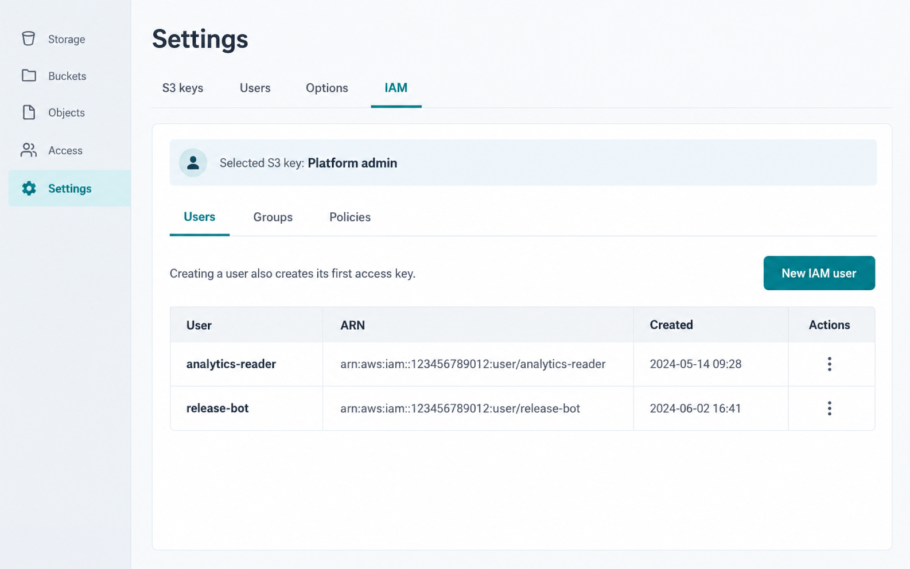

# Manage storage users, groups and policies (IAM)

---

# Manage storage users, groups and policies (IAM)

S3 Web UI can administer identities and permissions on a supported **storage backend**. This is separate from S3 Web UI's own local users and OIDC sign-in: the IAM tab changes the users, groups, access keys, and policies understood by the selected S3-compatible service.

*Illustrative example. The available controls and result columns depend on the selected backend and its permissions.*

## Before you begin

1. Sign in as an S3 Web UI administrator.
2. Select an S3 key that is allowed to call the storage backend's IAM or admin API.
3. Open **Settings → IAM**. The application probes the backend and reports the features it can use.

Every IAM call uses the S3 key selected for the current browser session. Changing the selected key can therefore change which identities are visible and which mutations are permitted. The IAM feature itself is enabled by default; set `IAM_ENABLED=false` to remove it entirely.

## Supported backends and capabilities

| Backend | Supported operations | Important notes |
|---|---|---|
| AWS | Users, groups, access keys, managed policies, policy attachments, and inline policies | AWS-managed policies are attach-only. Customer-managed policies can be edited or deleted. |
| Ceph RGW (Squid or newer) | Users, groups, access keys, managed-policy attachment, and inline policies | Requires an **account root user** key. Standalone policy CRUD is unavailable; use built-in policies or inline policies for fine-grained access. |
| RustFS 1.0+ | Users, groups, memberships, service-account keys, named policy CRUD, and policy attachments | Uses the native RustFS admin API. AWS-style inline policies are not available; use named policies. |
| MinIO | Not supported | MinIO exposes a different administration API. |

The capability probe is intentional: a supported provider can still expose only part of IAM when the selected key lacks permissions. The panel disables unavailable tabs or actions and explains why.

## Where to go next

| Task | Guide |
|---|---|
| Create backend users and access keys, manage groups | [IAM users, access keys and groups](IAM-Users-Groups.md) |
| Grant bucket access or write policies | [IAM policies and bucket access](IAM-Policies.md) |

## Audit and safety

IAM mutations made through this UI are recorded in **History**. They do not include changes made directly with an AWS, Ceph, or RustFS administration tool.

- Use a dedicated, least-privilege administration key rather than a general data-access key.
- Treat generated secret access keys as sensitive: the one-time display is the only recovery opportunity.
- Test new policies against non-production buckets and identities first.
- Confirm the active S3 key before applying a destructive IAM change.

For application-level key grants and local user administration, see the [administration overview](Administration.md). For storage endpoints and deployment settings, see [configuration reference](../Installation/Configuration.md).
