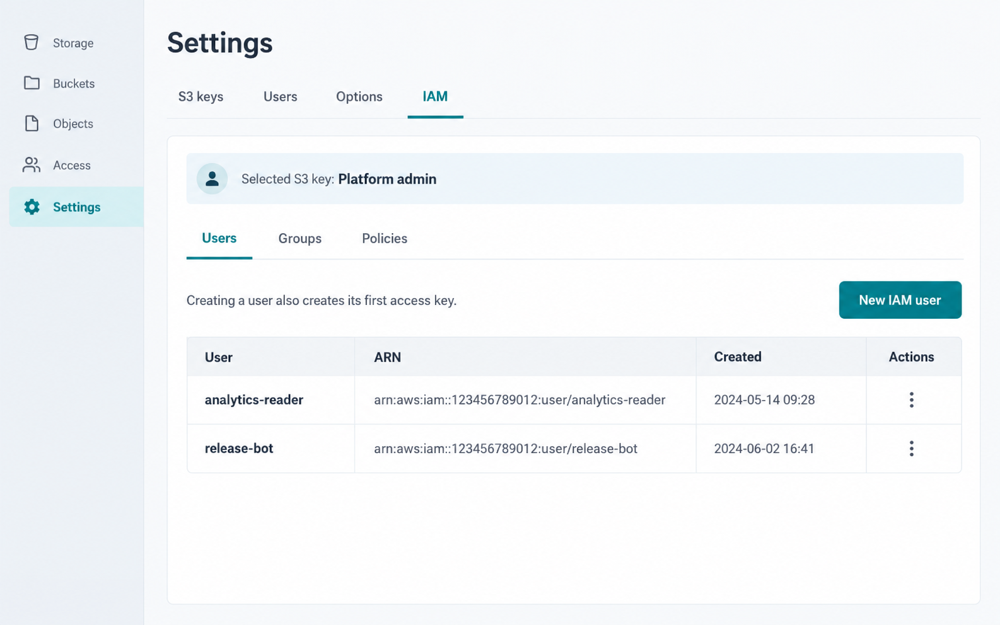

# IAM management

S3 Web UI can administer identities and permissions on a supported **storage backend**. This is separate from S3 Web UI's own local users and OIDC sign-in: the IAM tab changes the users, groups, access keys, and policies understood by the selected S3-compatible service.



*Illustrative example. The available controls and result columns depend on the selected backend and its permissions.*

## Before you begin

1. Sign in as an S3 Web UI administrator.
2. Select an S3 key that is allowed to call the storage backend's IAM or admin API.
3. Open **Settings → IAM**. The application probes the backend and reports the features it can use.

Every IAM call uses the S3 key selected for the current browser session. Changing the selected key can therefore change which identities are visible and which mutations are permitted. The IAM feature itself is enabled by default; set `IAM_ENABLED=false` to remove it entirely.

## Supported backends and capabilities

| Backend | Supported operations | Important notes |
|---|---|---|
| AWS | Users, groups, access keys, managed policies, policy attachments, and inline policies | AWS-managed policies are attach-only. Customer-managed policies can be edited or deleted. |
| Ceph RGW (Squid or newer) | Users, groups, access keys, managed-policy attachment, and inline policies | Requires an **account root user** key. Standalone policy CRUD is unavailable; use built-in policies or inline policies for fine-grained access. |
| RustFS 1.0+ | Users, groups, memberships, service-account keys, named policy CRUD, and policy attachments | Uses the native RustFS admin API. AWS-style inline policies are not available; use named policies. |
| MinIO | Not supported | MinIO exposes a different administration API. |

The capability probe is intentional: a supported provider can still expose only part of IAM when the selected key lacks permissions. The panel disables unavailable tabs or actions and explains why.

## Users and access keys

Select **Users → New IAM user** and enter the backend username. Creating a user also creates its first access key.

The resulting credential has two distinct effects:

1. It exists on the storage backend and is governed by that backend's IAM policies.
2. S3 Web UI saves it as an encrypted S3 key for the same endpoint, initially with **no application grants**.

The secret access key is displayed only once. Copy it before closing the result dialog. To allow a non-administrator to use the new key in S3 Web UI, go to **Settings → S3 keys**, open the generated key, and add user, role, group, or everyone-signed-in grants.

Additional keys are created from a user's access-key dialog. Deleting a key revokes that backend credential; deleting a user cleans up its backend keys, group memberships, and policy attachments before removal.

On RustFS, the user name is also the protected primary access key. Additional keys in the UI are RustFS service accounts. They inherit the parent user's policies and can be deleted independently. RustFS currently requires root credentials to create a service-account key for a different IAM user.

## Groups and memberships

The **Groups** tab creates and deletes groups. Open a group to add or remove members, then attach a policy to grant permissions to everyone in it. This is backend IAM grouping and is unrelated to an OIDC `groups` claim used for granting access to S3 Web UI's stored keys.

Use backend groups when you want the storage provider to enforce shared data permissions. Use OIDC group grants when you want S3 Web UI to decide which preconfigured S3 connection a signed-in person may select. The two can be used together, but they are separate systems.

## Policies

The **Policies** tab lists standalone managed policies when the backend supports them. Create or edit a customer/named policy with an IAM-style JSON document, then attach it to a user or group from that identity's **Permissions** dialog.

Policy behavior varies by provider:

- AWS provider-managed policies can be attached but not edited. AWS customer-managed policies can be edited and deleted.
- Ceph exposes its built-in managed policies for attachment but does not implement standalone policy CRUD. Use inline policies for fine-grained rules.
- RustFS uses named policies; create and attach those rather than inline policies.

Where supported, an inline policy lives directly on one user or group. It is useful for a narrowly scoped rule, such as granting access to one bucket. The JSON editor validates JSON before it sends it to the backend; it cannot guarantee that the backend will accept the policy semantics.

### Example: attach a managed or named policy to a user

1. Open **Users** and select the permissions action for the target backend user.
2. Under **Attach a policy**, select an available policy and choose **Attach**.
3. Confirm the policy appears under **Attached policies**. Use the detach action to remove it later.

On AWS, create a customer-managed policy from the **Policies** tab before attaching it. On RustFS, create a named policy and attach it. On Ceph, select a built-in managed policy when available or use the inline-policy option below.

### Example: inline policy for one user's upload prefix

Where inline policies are supported, open the user's **Permissions** dialog, select **Add inline policy**, enter a policy name such as `uploads-to-incoming`, and save a document like this:

```json
{
  "Version": "2012-10-17",
  "Statement": [
    {
      "Sid": "ListIncomingOnly",
      "Effect": "Allow",
      "Action": "s3:ListBucket",
      "Resource": "arn:aws:s3:::example-bucket",
      "Condition": { "StringLike": { "s3:prefix": ["incoming/*"] } }
    },
    {
      "Sid": "WriteIncomingObjects",
      "Effect": "Allow",
      "Action": ["s3:GetObject", "s3:PutObject", "s3:DeleteObject"],
      "Resource": "arn:aws:s3:::example-bucket/incoming/*"
    }
  ]
}
```

An inline identity policy deliberately has no `Principal`: the user receiving the attachment is the principal. This differs from a [bucket policy](../Usage/Bucket-Configuration.md#bucket-policy), which names the external principal in its document. Inline policies are unavailable on RustFS; create and attach a named policy there instead.

## Audit and safety

IAM mutations made through this UI are recorded in **History**. They do not include changes made directly with an AWS, Ceph, or RustFS administration tool.

- Use a dedicated, least-privilege administration key rather than a general data-access key.
- Treat generated secret access keys as sensitive: the one-time display is the only recovery opportunity.
- Test new policies against non-production buckets and identities first.
- Confirm the active S3 key before applying a destructive IAM change.

For application-level key grants and local user administration, see the [administration overview](Administration.md). For storage endpoints and deployment settings, see [Deployment](../Installation/Deployment.md).
