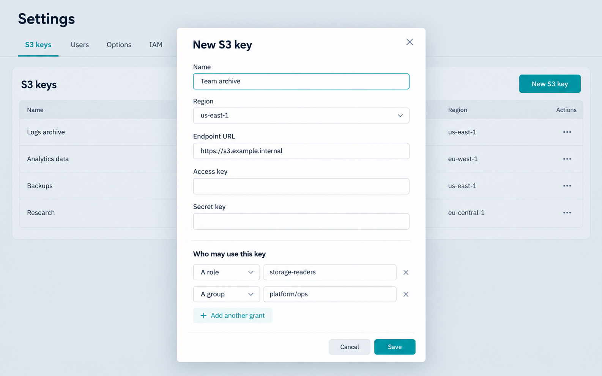

# Map OIDC roles and groups to S3 keys

OIDC tells S3 Web UI who someone is. This page explains how their identity-provider roles and groups decide which stored S3 connections they may select.

Create a stored S3 key in **Settings → S3 keys** and add a **role** or **group** grant. On every request, S3 Web UI compares the grants on the selected key with the authorities from the current OIDC login. A match makes the key available in the session picker; removing a role/group membership at the IdP takes effect after the user receives refreshed claims on a new login, while removing the grant in S3 Web UI takes effect immediately.

*Illustrative configuration example. Field labels and grant choices reflect the application; the endpoint and names are sample values.*

This is access mapping, not S3 credential provisioning: the configured key remains one shared, encrypted S3 connection. The user is allowed to select it because of their identity-provider membership. Use separate stored keys and grants when different teams need different S3 permissions.

The current claim mapping recognises these common Keycloak-style claim shapes, from either the ID token or the UserInfo response:

| IdP claim | Resulting grant type | Example value to enter in **Who may use this key** |
|---|---|---|
| `realm_access.roles: ["storage-readers"]` | A role | `storage-readers` |
| `resource_access.<client>.roles: ["storage-writers"]` | A role | `storage-writers` |
| `groups: ["/platform/ops"]` | A group | `platform/ops` |

The application internally prefixes these values as `ROLE_` and `GROUP_`; enter the unprefixed role or group value in the Settings form. Leading `/` characters in group paths are ignored, so both `/platform/ops` from the IdP and `platform/ops` in the grant refer to the same group.

For another IdP, configure its claim/mapper settings to emit one of the shapes above as an array of strings. Arbitrary claim names and nested role formats are not configurable in the UI today. A custom IdP mapper or a future application extension is needed when the provider cannot emit `realm_access.roles`, `resource_access.*.roles`, or `groups` in this form.

Application administrator status is deliberately different: it is read from the local S3 Web UI user record. An IdP role named `admin` can match an S3-key role grant, but it cannot make a person an S3 Web UI administrator.
