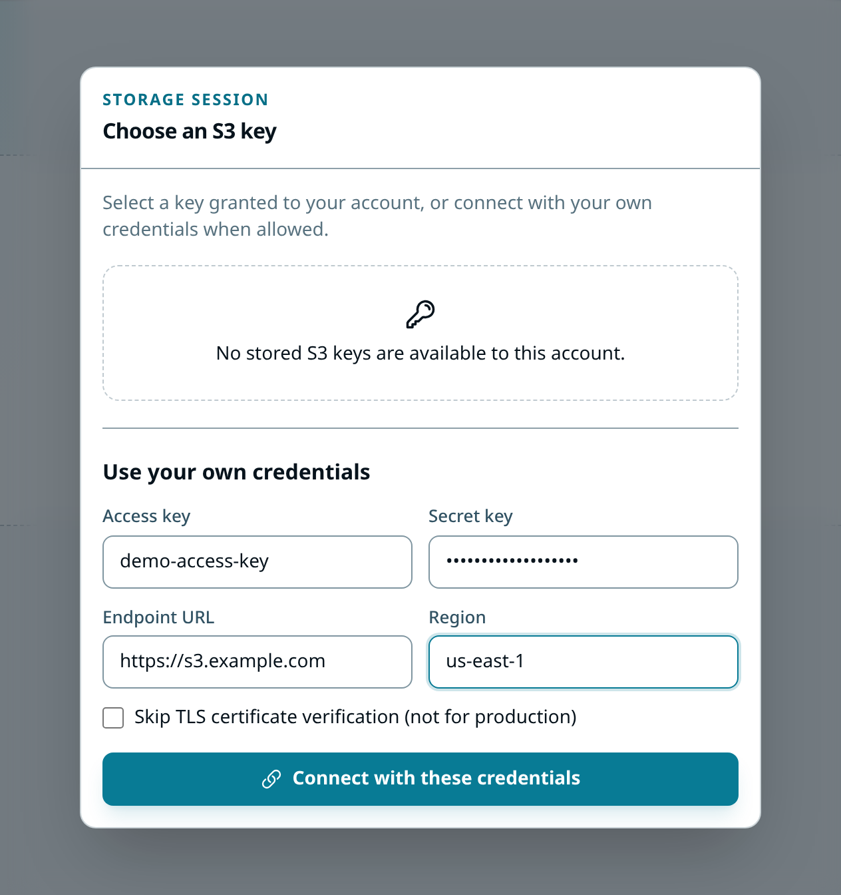

# First sign-in and connecting storage

S3 Web UI is running ([Docker](Docker.md) or [Helm](Helm.md)) and you want to sign in, connect an S3-compatible endpoint and upload a first file. The application works with endpoints such as AWS S3, Ceph RGW, RustFS and MinIO for normal object operations.

## 1. Sign in

Open the address of your instance, for example <http://localhost:8080>. On a new database, sign in with `admin@s3webui.local` / `admin`, then change the password under **Settings → Users**. If you set `ADMIN_PASSWORD` during installation, use that instead.

If you started the application with `S3_ACCESS_KEY`, `S3_SECRET_KEY` and `S3_ENDPOINT_URL`, a built-in S3 key is already available to every signed-in user and you can continue with step 3. It is read-only in the administration panel; its effective storage permissions still come from the S3 credential.

## 2. Connect an endpoint from the UI

After signing in, choose the key button in the top bar. If no stored key is granted to you, the connection dialog opens automatically. Enter your access key, secret key, endpoint URL, and region, then select **Connect with these credentials**.

This connection is held in the browser session. An administrator can disable this option in **Settings → Options**; in that case, use an S3 key assigned to your account instead.

## 3. Create a bucket and add an object

1. From **Buckets**, select **New bucket** and provide a bucket name accepted by your storage provider.
2. Open the bucket, then use **Upload** to select files or drag them into the dialog.
3. Use **New folder** to create a prefix. S3 folders are virtual; they are represented by object key prefixes rather than real directories.
4. Use the row actions to download, rename, or delete a file.

Files up to 5 MB use a regular form upload. Larger files use a server-proxied multipart upload with progress and estimated time remaining. The proxy avoids browser-to-S3 CORS requirements.

## Common first-run issues

| Symptom | What to check |
|---|---|
| No key is available | Add a key under **Settings → S3 keys**, add a complete `S3_ACCESS_KEY`, `S3_SECRET_KEY`, and `S3_ENDPOINT_URL` set, or allow own credentials. |
| Connection fails with a certificate error | Fix the endpoint certificate and use an HTTPS URL. The bypass option is for temporary development troubleshooting only. |
| Stored keys stopped working after a restart | Restore the original `/app/data` volume or the original `APP_ENCRYPTION_KEY`; a new key cannot decrypt old secrets. |
| The default password does not work | `ADMIN_PASSWORD` is used only while the user table is empty. Reset the existing account through an administrator or the database procedure used by your deployment. |

Continue with [Storage workflows](../Usage/Storage-Workflows.md) for day-to-day object work, [S3 key management](../Administration/S3-Key-Management.md) to make shared connections available to a team, or the [administration overview](../Administration/Administration.md) for the full overview.
