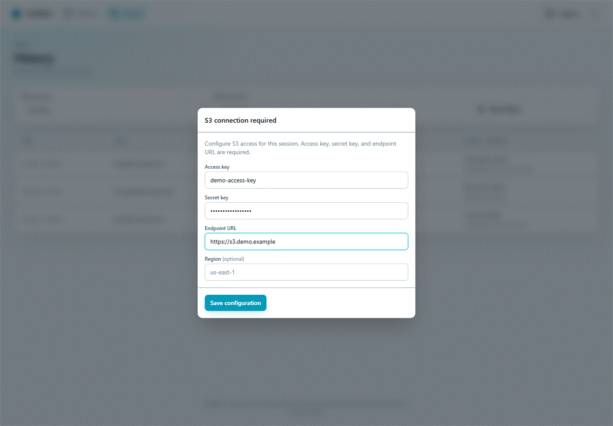

# Getting started

This guide starts S3 Web UI with an S3-compatible endpoint, connects it, and explains the first sign-in. The example uses RustFS, but the application works with compatible endpoints such as AWS S3, Ceph RGW, and MinIO for normal object operations.

## 1. Start storage and S3 Web UI

For a quick local test, run RustFS:

```bash
docker run -d --name rustfs -p 9000:9000 -p 9001:9001 \
  -v rustfs-data:/data \
  -e RUSTFS_ACCESS_KEY=S3WEBUI \
  -e RUSTFS_SECRET_KEY=s3webui-secret \
  -e RUSTFS_ADDRESS=:9000 \
  -e RUSTFS_CONSOLE_ADDRESS=:9001 \
  rustfs/rustfs:latest /data
```

Then start S3 Web UI. The data volume is deliberate: it preserves users, stored S3 keys, and the generated encryption key across container replacement.

```bash
docker run -d --name s3webui -p 8080:8080 \
  --add-host=host.docker.internal:host-gateway \
  -v s3webui-data:/app/data \
  -e S3_ACCESS_KEY=S3WEBUI \
  -e S3_SECRET_KEY=s3webui-secret \
  -e S3_ENDPOINT_URL=http://host.docker.internal:9000 \
  ghcr.io/wenisch-tech/s3webui:latest
```

Open <http://localhost:8080>. On a new database, sign in with `admin@s3webui.local` / `admin`, then change the password under **Settings → Users**.

The three `S3_*` values above create a built-in S3 key available to all signed-in users. It is read-only in the administration panel; its effective storage permissions still come from the S3 credential. Alternatively, leave the variables unset and add keys in the application as described below.

## 2. Connect an endpoint from the UI

After signing in, choose the key button in the top bar. If no stored key is granted to you, the connection dialog opens automatically. Enter your access key, secret key, endpoint URL, and region, then select **Connect with these credentials**.



This connection is held in the browser session. An administrator can disable this option in **Settings → Options**; in that case, use an S3 key assigned to your account instead.

## 3. Create a bucket and add an object

1. From **Buckets**, select **New bucket** and provide a bucket name accepted by your storage provider.
2. Open the bucket, then use **Upload** to select files or drag them into the dialog.
3. Use **New folder** to create a prefix. S3 folders are virtual; they are represented by object key prefixes rather than real directories.
4. Use the row actions to download, rename, or delete a file.

Files up to 5 MB use a regular form upload. Larger files use a server-proxied multipart upload with progress and estimated time remaining. The proxy avoids browser-to-S3 CORS requirements.

## Common first-run issues

| Symptom | What to check |
|---|---|
| No key is available | Add a key under **Settings → S3 keys**, add a complete `S3_ACCESS_KEY`, `S3_SECRET_KEY`, and `S3_ENDPOINT_URL` set, or allow own credentials. |
| Connection fails with a certificate error | Fix the endpoint certificate and use an HTTPS URL. The bypass option is for temporary development troubleshooting only. |
| Stored keys stopped working after a restart | Restore the original `/app/data` volume or the original `APP_ENCRYPTION_KEY`; a new key cannot decrypt old secrets. |
| The default password does not work | `ADMIN_PASSWORD` is used only while the user table is empty. Reset the existing account through an administrator or the database procedure used by your deployment. |

Continue with [Storage workflows](../Usage/Storage-Workflows.md) for day-to-day object work, [S3 key management](../Administration/S3-Key-Management.md) to make shared connections available to a team, or the [administration overview](../Administration/Administration.md) for the full overview.
