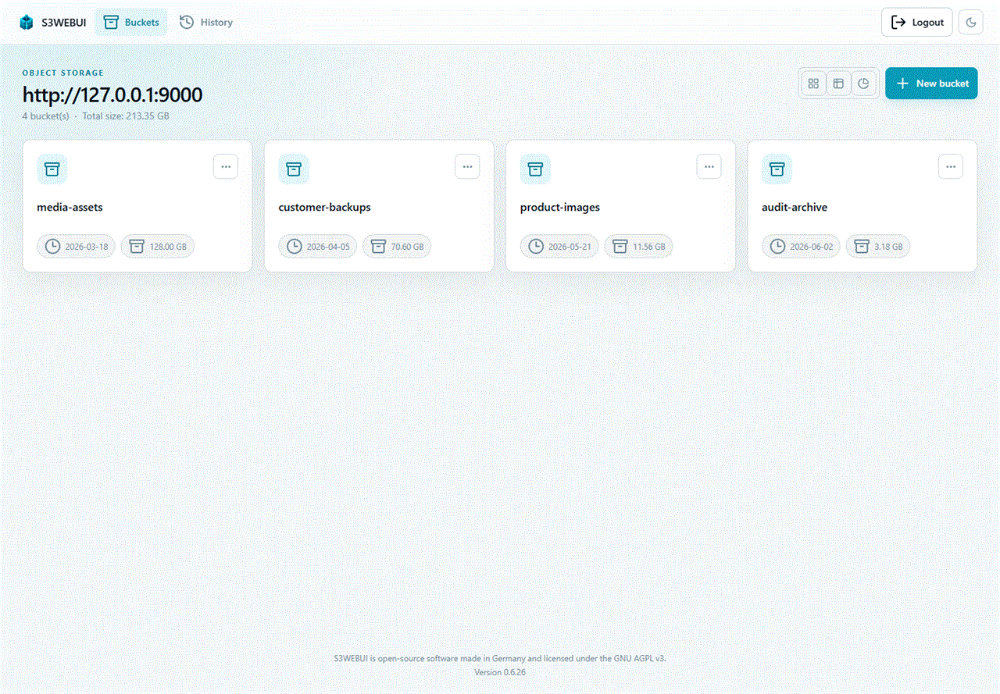
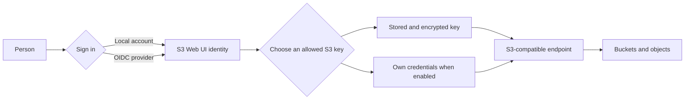

# S3 Web UI documentation

S3 Web UI is a browser interface for S3-compatible object storage. It separates the person using the application from the S3 credentials used for a storage session: an administrator stores and grants named S3 keys, then users select an allowed key before browsing buckets.

## Start here

Choose the section that matches your task:

- [Installation](Installation/README.md) — first run, Docker and PostgreSQL deployment, and Helm.
- [Usage](Usage/README.md) — buckets, objects, uploads, search, CORS, policies, and history.
- [Administration](Administration/README.md) — S3 keys, grants, local users, OIDC, and storage-backend IAM.

## How access fits together

An S3 key is a named endpoint, access key, secret key, and region. It is not an application user. Grant rules decide which signed-in identities may select it. Administrators can use every stored key.

## Important safety notes

- Change the initial administrator password before exposing the service.
- Persist `/app/data` when using the bundled H2 database. It holds both the database and, unless supplied explicitly, the encryption key that protects stored S3 secrets.
- Do not enable **Skip TLS certificate verification** in production.
- `DISABLE_AUTHENTICATION=true` makes every visitor an administrator. Put it behind a trusted network boundary only.

For configuration reference and examples, begin with [Installation](Installation/README.md). For access configuration, continue to [Administration](Administration/README.md).
