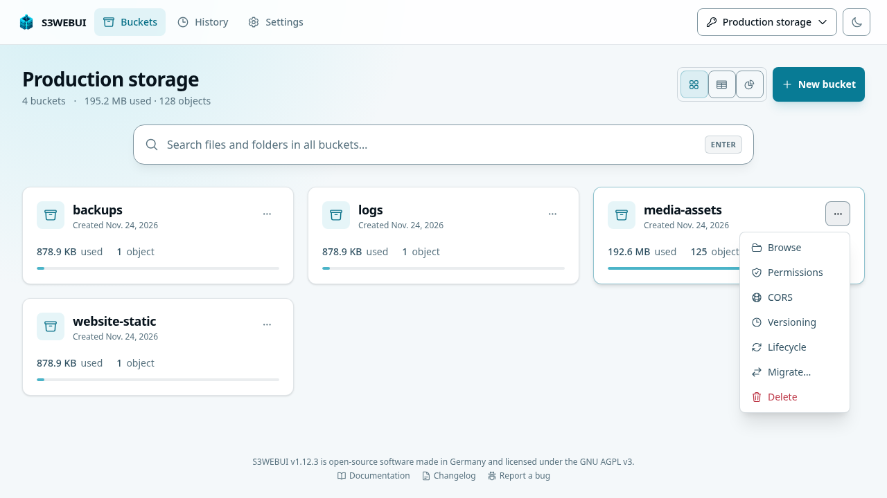
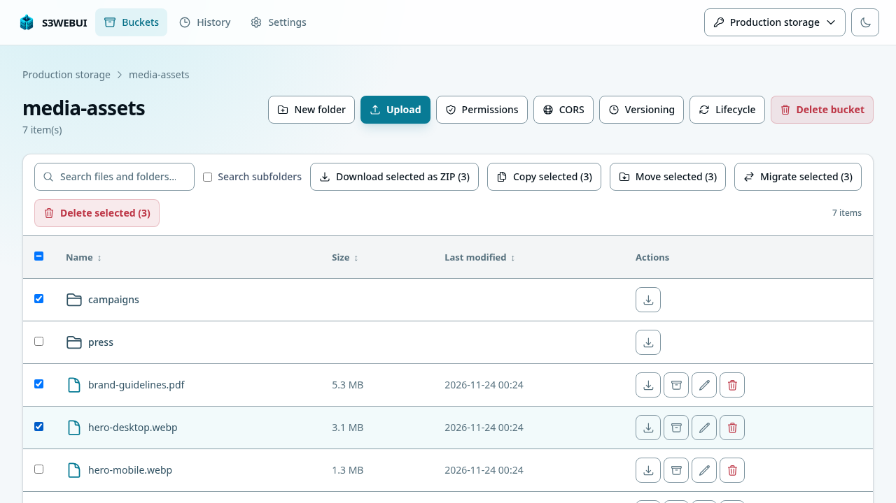
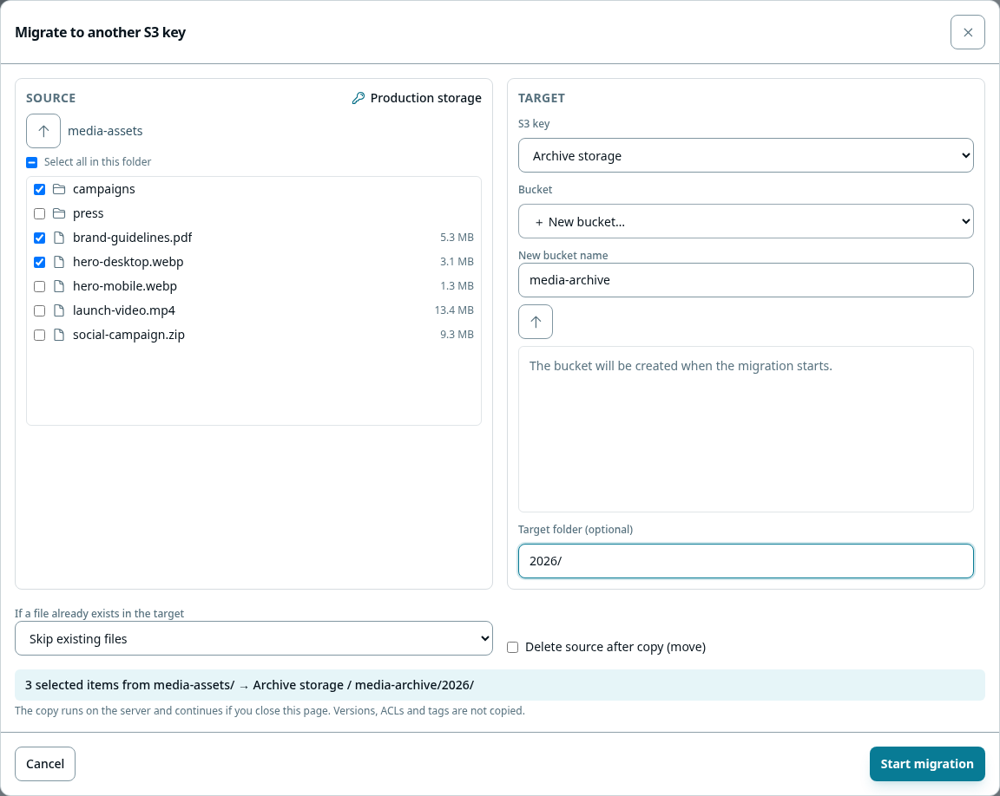
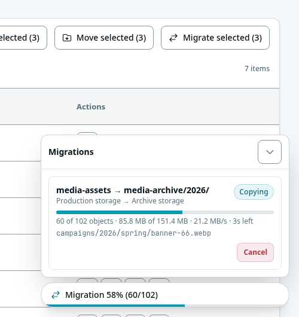
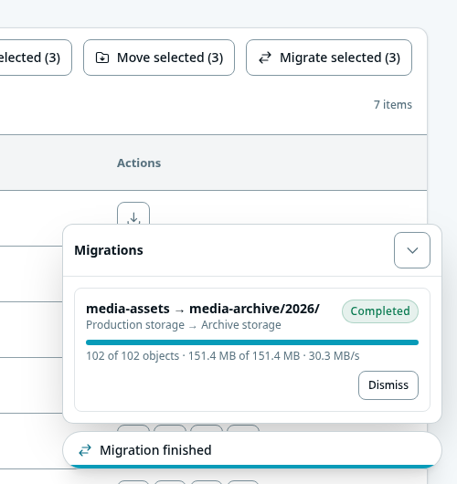

# Migrate data between S3 keys

Use **Migrate** to copy or move buckets, folders and files from the S3 key you are working with to a different S3 key. It is meant for changing storage provider, consolidating accounts, or creating an archive copy in another account.

The data travels from one storage endpoint to the other through the server. It is never downloaded to your browser, so a slow connection or a closed laptop does not slow the copy down or stop it.

- **Two-pane dialog.** Pick what to migrate on the left and where it goes on the right, like a classic two-pane file manager.
- **Runs on the server.** A migration keeps going when you close the tab, sign out, or when the server restarts.
- **Live progress.** A widget in the bottom-right corner of every page shows what has been copied, with a **Cancel** button.

## Start a migration

You can start a migration in two places.

**From a bucket.** Open the **⋯** menu of a bucket card (or table row) and choose **Migrate…** to migrate the whole bucket.

**From a selection.** Inside a bucket, tick any files and folders and select **Migrate selected**. Only the ticked items are migrated.

## Choose the source and the target

**Source (left)** is the S3 key you are signed in with. Browse into folders and tick the items to migrate. The selection is kept while you move between folders. If you tick nothing, everything below the starting path is migrated: the whole bucket when you came from the bucket menu, or the current folder when you came from a bucket view.

**Target (right)** is where the data goes:

| Control | Use it to |
|---|---|
| **S3 key** | Choose the destination key. Every key you may use is listed, including the current one. |
| **Bucket** | Pick an existing bucket of that key, or **New bucket…** to create one when the migration starts. |
| **Folder list** | Browse the folders of the chosen bucket and click one to use it as the destination. |
| **Target folder** | Type a destination folder directly. Leave it empty to write to the bucket root. |

The line above the buttons summarises the migration, for example *3 selected items from media-assets/ → Archive storage / media-archive/2026/*. Check it before you start.

### If a file already exists in the target

| Option | Result |
|---|---|
| **Skip existing files** | The existing target file is kept. This is the default and the safest choice. |
| **Overwrite existing files** | The target file is replaced by the source file. |
| **Overwrite only if source is newer** | The target file is replaced only when the source was modified more recently. |

### Move instead of copy

Tick **Delete source after copy (move)** to turn the migration into a move. Each source object is deleted only after it has arrived in the target, or was found there with the same size. Objects that fail to copy are never deleted from the source.

## Follow the progress

After you select **Start migration**, the progress widget opens in the bottom-right corner. It stays visible on every page, including after you reload or come back later.

For each migration the widget shows:

- the source bucket and target, and the two keys involved;
- the status: *Queued*, *Scanning*, *Copying*, *Cancelling*, *Completed*, *Completed with errors*, *Failed* or *Cancelled*;
- a progress bar with the number of objects and bytes handled, the current speed and the estimated time left;
- the object being copied right now;
- counters for skipped and failed objects, with the error of each failed object (the first 50 are kept).

The collapsed widget is a single line, such as *Migration 58% (60/102)*. Select it to expand the details and select the chevron to collapse it again.

**Cancel** stops a migration after the objects currently in transit. Objects that already arrived stay in the target, and nothing is rolled back. It asks for a second click to confirm.

When a migration ends, a notification appears and the widget shows the result. Select **Dismiss** to remove a finished migration from the list.

Finished migrations disappear from the widget after six hours, and are deleted after 30 days (see [Migration settings](../Installation/Configuration.md#migration-settings)). The [activity history](Audit-History.md) records when each migration started and how it ended.

## What gets copied

Every object is streamed from the source key to the target key. Objects up to 64 MiB are copied with one request. Larger objects are copied as a multipart upload, so there is no practical size limit. A multipart upload that fails or is cancelled is aborted, so no incomplete parts are left behind.

The destination path follows the same rule as copying inside a bucket. Folders keep their name below the target folder, and a whole bucket is copied key for key.

| You migrate | Target folder | Result |
|---|---|---|
| Whole bucket `media-assets` | `backup/` | `backup/brand-guidelines.pdf`, `backup/campaigns/…` |
| Folder `campaigns/` | `2026/` | `2026/campaigns/…` |
| File `brand-guidelines.pdf` | `2026/` | `2026/brand-guidelines.pdf` |
| Nothing ticked while viewing the folder `press/` | `2026/` | `2026/…`, without the `press/` part, because the folder you started from is the root of the migration |

Content type, cache headers, content encoding and disposition, content language, and user metadata are copied with each object. **Object versions, ACLs and tags are not copied.** Only the current version of each object is migrated.

## Closing the browser and restarting the server

A migration is stored in the application database, together with the ids of the two keys (never their secrets). That is what lets it outlive your session.

- **Closing the tab or signing out** does not affect a running migration. Open S3 Web UI again and the widget shows the current state.
- **Restarting the server** resumes unfinished migrations on their own. The migration scans the source again and skips every object that already arrived, so nothing is copied twice and an interrupted overwrite does not start over. The counters start from zero again, which is why a resumed migration reports many *skipped* objects.

> **Note:** The server recognises objects copied before an interruption by size and by their modification time in the target. This assumes the clocks of the storage servers are roughly in step. If a target server's clock is far off, some objects may be copied again after a restart; nothing is ever deleted from the source in that case unless the copy was verified.

## Who can see and use migrations

- You can start a migration only with keys you are allowed to use. Access to both keys is checked when you start it.
- You see, cancel and dismiss **your own** migrations. Administrators see everyone's.
- A migration reads its two keys when it starts, and again if it is resumed after a restart. If an administrator disabled or deleted a key before that point, the migration ends with the status *Failed* and a message that names the problem.

## Requirements and limits

- The source must be a **stored key** or the built-in key. Credentials you typed in for a single session cannot be used, because a migration has to be able to resume without you. Ask an administrator to add the key, or enable *auto-store keys*.
- Source and target may be on the same endpoint, but the target cannot be inside the folder you are migrating, because that would copy it into itself.
- Several migrations can run at the same time. By default two run in parallel and the others wait as *Queued*.
- A migration creates the target bucket if needed, but it does not copy bucket settings such as policies, CORS rules, versioning or lifecycle rules. Configure those on the new bucket afterwards. See [Bucket configuration](Bucket-Configuration.md).

## Troubleshooting

| Message or symptom | What it means and what to do |
|---|---|
| *Migration needs a stored S3 key as the source* | You are using credentials typed in for this session. Switch to a stored key in the key picker. |
| *The target is inside the source folder* | Choose a target folder outside the folder you are migrating, or another bucket. |
| *The selected S3 key no longer exists* or *has been disabled* | The key was removed or disabled by an administrator. Choose another key. |
| *You are not allowed to use the S3 key…* | You have no grant for the target key. Ask an administrator. |
| *Could not list the buckets of that key* | The target key cannot list buckets. Choose **New bucket…** and type the name of a bucket you can write to. |
| Status *Completed with errors* | Some objects failed. Expand the migration to read the errors, fix the cause, and start the migration again with **Skip existing files** so only the missing objects are copied. |
| Status *Failed* | The migration could not start or lost access to a key. The message in the widget names the reason. |
| Many objects *skipped* | Expected when objects already exist in the target, or when a migration was resumed after a restart. |

## Settings

Administrators can tune how many migrations run at once, how many objects are copied in parallel, and the multipart sizes. See [Migration settings](../Installation/Configuration.md#migration-settings). The migration endpoints are described in the [API reference](../Administration/API.md#migrations).

## Related guides

- [Work with buckets and files](Storage-Workflows.md)
- [Review the activity history](Audit-History.md)
- [S3 key management](../Administration/S3-Key-Management.md)
