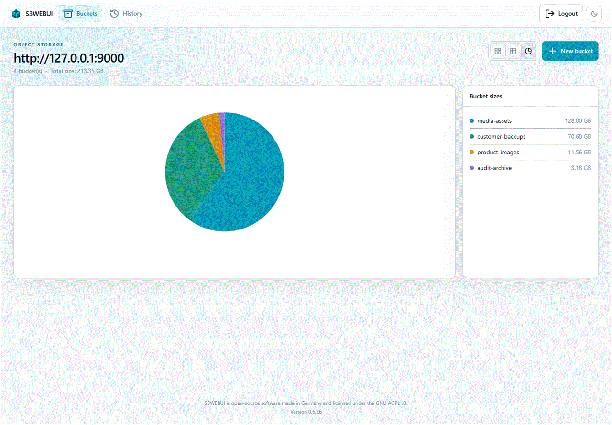

# Storage workflows

This guide covers the bucket browser, object operations, search, uploads, and storage statistics. The underlying S3 key decides what the storage service permits; S3 Web UI does not add permissions to that key.

*Product-tour capture. Statistics are calculated for the active S3 key and can be unavailable when the backend cannot return them.*

## Bucket views and statistics

On **Buckets**, use the view buttons to select cards, a sortable table, or a chart. The table and chart display each bucket's object count and total size, while the page also calculates a total. These values are loaded after the bucket list itself; they may briefly show as calculating or unavailable.

The table sorts by name, creation date, size, and object count. The active S3 key limits every view to the buckets it can list.

## Browse and search objects

Open a bucket to browse prefixes using the breadcrumb. S3 uses object keys, so folders are virtual prefixes rather than filesystem directories. **New folder** writes the prefix marker used by the interface.

- Sort the object table by name, size, or last-modified time.
- Use the current-path search to filter visible files and folders as you type.
- Enable **Search subfolders** to include matches below the current prefix.
- Use global search for all buckets available to the selected S3 key. Queries need at least two characters; the five-minute per-session catalogue is rebuilt when you choose refresh or change the active S3 key.

## Upload files

Select **Upload** and choose files or drop them onto the dialog. Duplicate selections with the same name and size are ignored. Files are uploaded one at a time, so progress and a final success/failure count are clear for each file.

| File size | Transfer method |
|---|---|
| 5 MB or smaller | Regular form upload through S3 Web UI |
| Larger than 5 MB | Server-proxied S3 multipart upload with 5 MB parts |

Multipart parts are proxied through the application, avoiding browser-to-S3 CORS requirements. The UI shows per-file and overall progress. After a completed batch, select **Upload another batch** to clear the list and begin again. Closing the dialog reloads the bucket when at least one upload succeeded.

The application accepts requests up to 5 GB by default. The multipart endpoint also rejects a single part larger than 5 GB. Upload failures leave the affected file marked as failed while later files in the batch continue; retry the file after fixing the endpoint, permission, or network issue.

## Copy, move, rename, and delete

Use the object-row actions for one file, or select multiple rows for bulk actions.

| Action | Result |
|---|---|
| Download | Streams the selected object through S3 Web UI. |
| Rename | Creates the object with its new key and removes the old key. |
| Copy | Copies selected objects or complete selected folders to a bucket and optional destination prefix; sources remain. |
| Move | Performs the same transfer, then removes the sources. |
| Delete | Removes selected objects. Selecting a folder applies to its contents. |

When copying or moving a folder, its own name is preserved below the destination prefix. For example, moving `reports/` to `archive/` produces `archive/reports/...`. Transfers and renames are composed of S3 operations, not filesystem moves; avoid interrupting a large operation and verify the destination before deleting the source yourself.

Deleting a non-empty bucket requires an explicit **Delete everything** confirmation. The application removes object versions and delete markers in batches before it deletes the bucket.

## Related guides

- [Bucket policies and CORS](Bucket-Configuration.md)
- [Audit history](Audit-History.md)
- [S3 key management](../Administration/S3-Key-Management.md)
