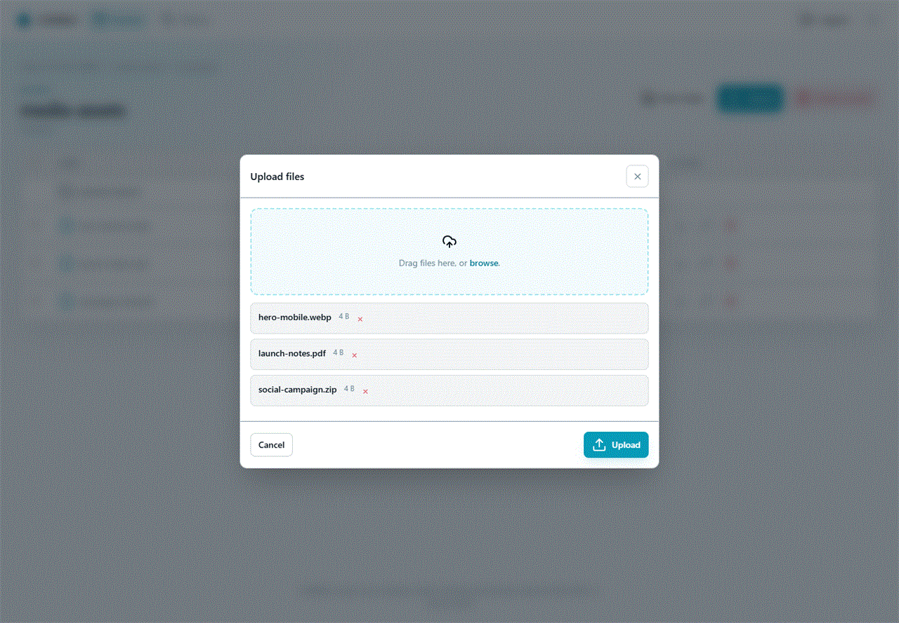

# User guide

This is a short orientation for day-to-day work. For step-by-step object operations, see [Storage workflows](Storage-Workflows.md); for security-sensitive bucket settings, see [Bucket policies and CORS](Bucket-Configuration.md).

## Select an S3 key

The key button in the top bar shows the storage connection for the current browser session. Select it to switch to another stored key you have been granted, or to connect with your own credentials when the administrator permits it. Changing the key changes the buckets and objects you can see; it does not sign you out.

## Browse and search

- **Buckets** displays the buckets reachable with the active key. Switch between grid, table, and chart views; sort, create, or delete buckets.
- Open a bucket to navigate its prefixes with breadcrumbs. Object rows can be sorted by name, size, and last-modified time.
- The search field in a bucket filters the current path as you type. Enable **Search subfolders** when the desired item may be below the current prefix.
- The global search control searches every bucket available to the active key. It shows top suggestions and a paginated result page. Its per-session catalogue is cached for five minutes; use refresh when you need a new listing immediately.

## Upload, download, and organise

Select **Upload** in a bucket to add one or more files. The dialog accepts drag and drop. Large files continue as multipart uploads through S3 Web UI and show progress, transfer rate, and an ETA.

Use the object row controls to download or rename an object. Select multiple objects to copy, move, or delete them. Moving and renaming create keys at the destination; do not interrupt the operation or assume an object is atomic across different S3 providers.

Use **New folder** to create a virtual prefix. Removing a folder means deleting its contents; S3 does not have physical folders.

## Bucket settings

Within a bucket, administrators and users with the underlying S3 permissions can open:

- **Policy** to read, edit, or remove the bucket IAM policy. The editor validates JSON before it is sent to the storage service.
- **CORS** to manage browser-origin rules in the `aws s3api` JSON shape. This configures the bucket, not S3 Web UI itself.
- **Delete bucket** to remove an empty bucket. If the provider reports that it is not empty, the UI offers an explicit **Delete everything** confirmation.

Treat a bucket policy and a CORS rule as production security settings. Test changes against a non-production bucket first, especially wildcard origins or broad policy principals.

For JSON examples and troubleshooting, see [Bucket policies and CORS](Bucket-Configuration.md).

## History

**History** shows activity performed through S3 Web UI, including uploads, downloads, deletes, renames, and IAM changes. Filter the table by user or action to investigate a workflow.

The history is an application audit trail, not an exhaustive S3 server audit log. Actions performed outside S3 Web UI are not added to it.

For audit visibility and retention, see [Audit history](Audit-History.md).

## Theme and access messages

Use the sun/moon button to choose light or dark appearance. The preference is saved in the browser's local storage. If a previously available key disappears or a request is denied, ask an administrator to verify the key grant and the permissions supplied by the underlying S3 credential.
